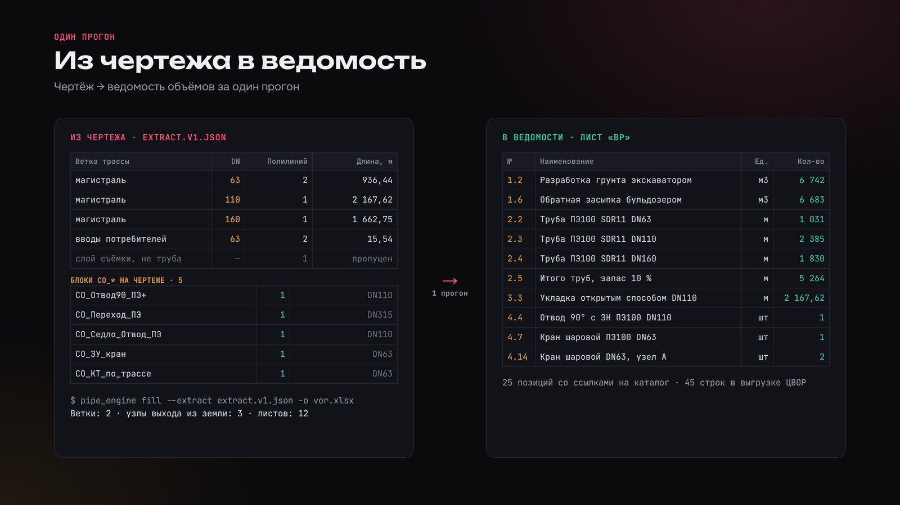
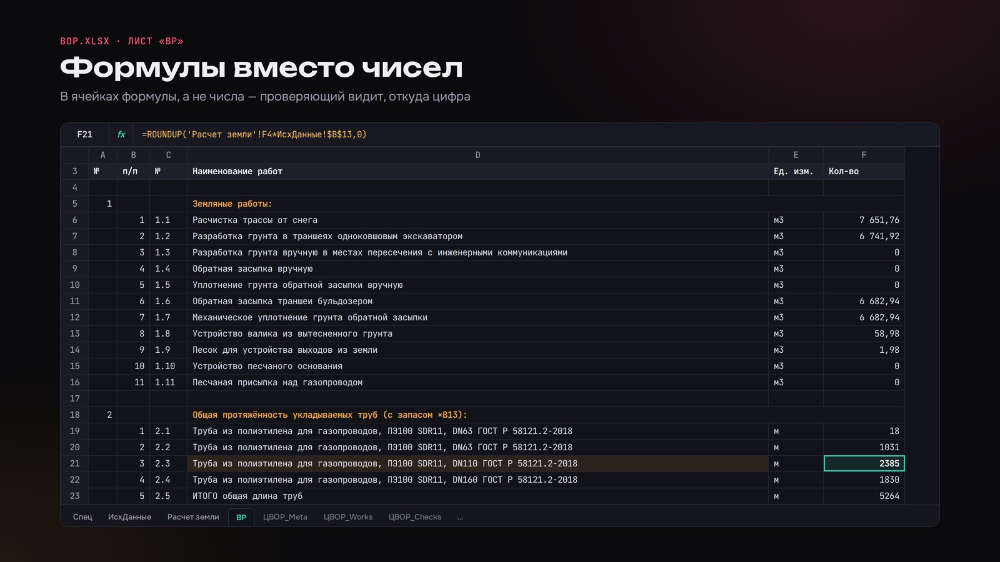

# Из чертежа газопровода в Excel-ведомость объёмов работ

Python-движок, который превращает выгрузку из чертежа газопровода в ведомость объёмов работ (ВОР) в Excel. На входе — JSON с трассой и блоками спецификации, который ИИ-агент выгружает из DWG через MCP-инструмент `extract_so_blocks_from_route` (репозиторий `cad-agent-mcp`). На выходе — книга из 12 листов: спецификация, исходные данные, расчёт земляных работ, ведомость работ и листы для выгрузки в ЦВОР.

Главное правило движка: в ячейки пишутся формулы Excel, а не готовые числа. Проектировщик открывает книгу, видит, откуда взялось каждое значение, меняет исходные данные (глубину заложения, ширину траншеи, толщину снега) — и Excel пересчитывает всю ведомость.

Вместо ручного подсчёта длин труб по диаметрам, фитингов и объёмов грунта — один запуск команды; проверка остаётся за инженером, но уже по формулам.





## Как это работает

1. **Вход** — `extract.v1.json` (схема v1): полилинии трассы (слой, длина, начало/конец) и блоки `СО_*` с атрибутами (наименование, код, ед. изм., количество, масса).
2. **Ветки по слоям** — имя слоя разбирается регулярным выражением: роль ветки, давление, DN. Слои, не относящиеся к трубам (например, съёмка), пропускаются.
3. **Узлы** — блоки собираются в узлы по 17 шаблонам (`pipe_engine/data/node_templates/`): отводы, переходы, седловые отводы, краны, контрольные трубки, вводы, футляры и т. д.
4. **Каталог** — позиции подбираются из SQLite-каталога (`catalog/pipe_catalog.db`, 995 позиций) по тегу и DN.
5. **Земляные работы** — по геометрии траншеи: открытая прокладка, ГНБ, совместная прокладка, песок, подушка, снег, приямки (формулы листа «Расчет земли» перенесены в Python и сверены с эталонной книгой).
6. **Запись xlsx** — openpyxl, все расчётные ячейки — формулы.

Листы книги: «Спец», «ИсхДанные», «Расчет земли», «ВР», «ЦВОР_Meta», «ЦВОР_Files», «ЦВОР_Sections», «ЦВОР_Works», «ЦВОР_Resources», «ЦВОР_Links», «ЦВОР_Signatures», «ЦВОР_Checks».

## Запуск на демо-данных

Нужен Python 3.10+.

```bash
python -m venv .venv
source .venv/bin/activate          # Windows: .venv\Scripts\activate
pip install openpyxl

python -m pipe_engine.cli fill --extract examples/extract.v1.json -o vor.xlsx
```

Команда запускается из корня репозитория. Вывод на демо-примере:

```
Loaded extract: 7 polylines, 5 blocks
Branches built: 2
  consumer_inlets_г1_stage3: DN63=15.5м
  main_г1_stage3: DN63=936.4м, DN110=2167.6м, DN160=1662.7м
Exit-sand nodes: 3
Wrote: vor.xlsx (30.4 KB)
```

Параметры проекта и траншеи задаются флагами: `--depth`, `--sand-pad`, `--snow`, `--bottom-width`, `--slope`, `--soil`, `--season`, `--laying-method`, счётчики ручных узлов (`--grpsh-count`, `--vrezka-count` и др.). Полный список — `python -m pipe_engine.cli fill --help`.

`examples/extract.v1.json` — обезличенный демо-пример: условный путь к чертежу, изменённые длины, поставщики заменены на «Поставщик N».

## Тесты

```bash
pip install pytest openpyxl formulas   # formulas — для проверки вычисления формул
python -m pytest -q
```

180 тестов: разбор схемы и слоёв, построение веток, шаблоны узлов, каталог, земляные работы (регрессия против значений эталонной книги), структура листов, вычисление формул книги и сравнение с расчётом на Python.

## Структура

```
pipe_engine/
  cli.py              команда fill
  io_schema.py        схема extract.v1.json
  interpret.py        ветки по слоям, подсчёт фитингов, узлы выхода из земли
  trench_profile.py   геометрия траншеи (ширина, откосы по СП 45.13330)
  earthwork.py        земляные работы
  node_library.py     шаблоны узлов → состав
  catalog_loader.py   SQLite-каталог
  xlsx_writer.py      сборка книги
  spec_writer.py      лист «Спец»
  vr_writer.py        лист «ВР»
  cvor_writer.py      листы ЦВОР
  data/node_templates/  17 JSON-шаблонов узлов
catalog/pipe_catalog.db  каталог (995 позиций, поставщики обезличены), справочники DN и климатологии
examples/extract.v1.json демо-вход
tests/                   тесты и фикстуры
docs/                    изображения для README
```

## Стек

Python 3.10+, openpyxl, SQLite, pytest, formulas (проверка формул).

## Автор

Telegram-канал [@sitimlab](https://t.me/sitimlab) · сайт [sitimlab.ru](https://sitimlab.ru/?utm_source=github&utm_medium=profile)

## Лицензия

MIT, см. [LICENSE](LICENSE).
